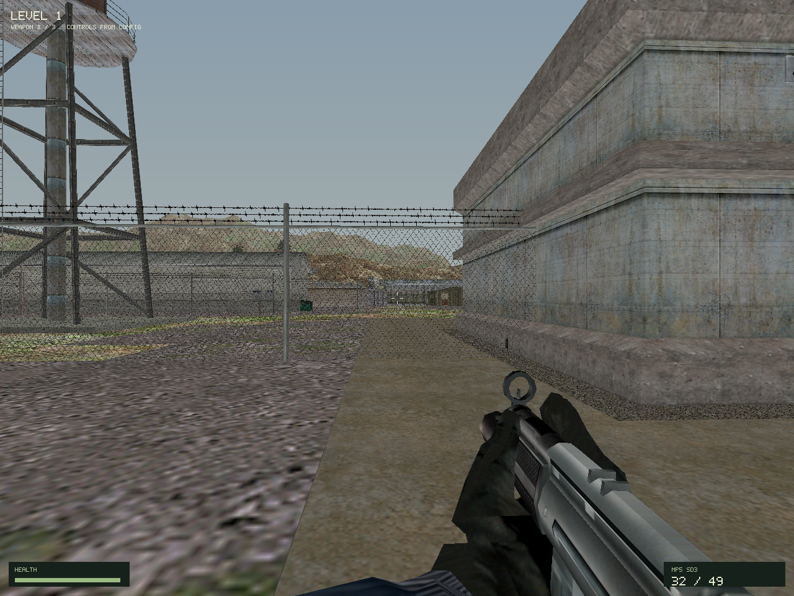
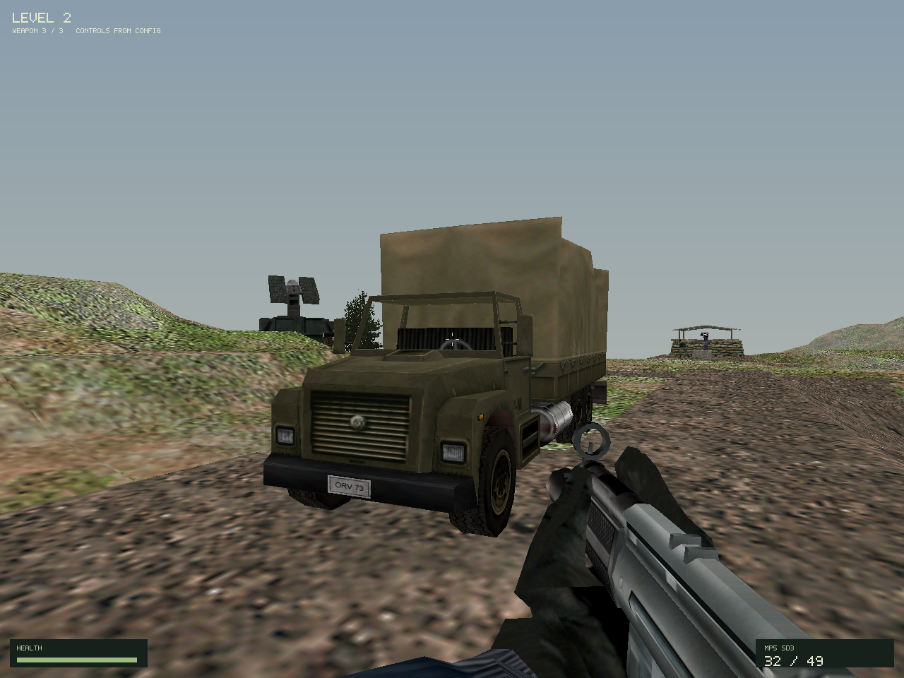
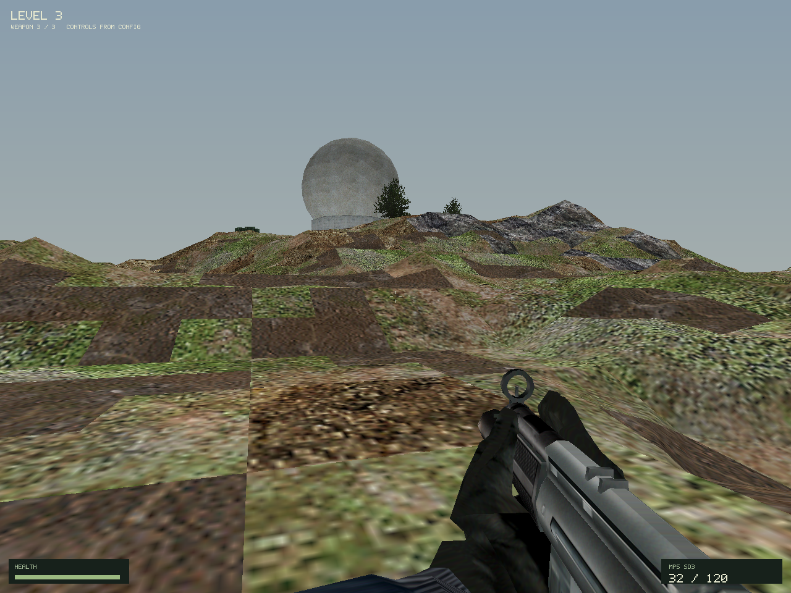

# Project Open I.G.I.

An open-source native implementation of the Project I.G.I. game engine, built
in C++20 for all major desktop operating systems — Windows, macOS, and Linux.
It was written from scratch in C++, reverse-engineered with Binary Ninja and
Ghidra from the retail `igi.exe`, using the
[project-igi-natives](https://github.com/heaven-hm/project-igi-natives)
research — 4000+ cataloged native functions to start from — and took help from
the C# [OpenIGI](https://github.com/OpenIGI/OpenIGI) reference. Original game
data is loaded from the retail game folder and the runtime reproduces the
original game byte-for-byte. The first implementation milestone focuses on
player locomotion, physics, weapons, and enemy AI.

## Current state

The repository builds a C++20 gameplay library, a fixed-step application loop,
asset and native diagnostic probes, and a C++ SDL2 application shell packaged
as `igi.app` on macOS (native binaries on Windows and Linux).

**Working in 0.1 BETA (demo):**

- Player
- AI
- Weapons
- Graphs
- Terrain
- Textures
- MEF models

None of these are complete, but together they are enough to play a short demo
from `igi.app`.

**Not working yet:**

- Main Menu
- Magic Objects
- Sound
- Movies
- Cutscenes

See [the first gameplay demo plan](GAMEPLAY_DEMO_PLAN.md)
and [verification notes](engine/VERIFICATION.md). Runtime parity against the
original game remains to be measured.

## Screenshots

Level spawn renders captured from the engine (1280x960):







## Credits and prior work

Written from scratch in C++, but the following projects were a great help:

- [project-igi-natives](https://github.com/heaven-hm/project-igi-natives) —
  native-function research via DLL injection; its catalog of 4000+ natives was
  the starting point for the reverse engineering.
- [project-igi-editor](https://github.com/heaven-hm/project-igi-editor) — file
  formats and terrain were already created here in C++; a great help.
- [project-igi-converter](https://github.com/heaven-hm/project-igi-converter) —
  the C++ asset converter (IGI1Conv/IGI2Conv); its file-format parsers were a
  great help.
- [OpenIGI](https://github.com/OpenIGI/OpenIGI) — the C# reference
  implementation we took help from as a cross-check.
- [Project-IGI-Terrain](https://github.com/hjcminus/Project-IGI-Terrain) —
  the Terrain Editor by hjcminus that project-igi-editor is based on.

Retained upstream license and provenance notices live in
`engine/third_party/licenses/`.

## Platform scope

The game core is designed to be OS-independent: gameplay, physics, AI, weapons,
scripting, and file formats must not call operating-system APIs. Windowing,
graphics, input, filesystem, and audio APIs belong behind platform interfaces.
The project targets all major desktop operating systems — Windows, macOS, and
Linux — and is not tied to any single platform.

## Branch and release policy

`develop` is the integration branch for experimental work. Version tags such as
`v0.1.0-alpha.1`, `v0.1.0-beta.1`, `v0.1.0-rc.1`, or
`v0.1.0-experimental.1` create GitHub prereleases only when their commit is part
of `develop`. Stable version tags such as `v0.1.0` create GitHub releases only
when their commit is part of `main`. Feature branches are not release sources.

The release workflow currently publishes source snapshots only. The `igi.app`
runs a playable demo slice (see Current state); releases must describe the
demo honestly and list what is not working yet. See [release policy](docs/RELEASE_POLICY.md).

## Build

Requirements: CMake 3.20+, a C++20 compiler, SDL2, and either an SDL2 CMake
package or pkg-config metadata.

```sh
cmake -S . -B build
cmake --build build
```

The core is C++20 because the platform, renderer, and gameplay systems need a
native ABI and deterministic low-level control. C and Rust can be used for
specific components when their ABI or performance benefits are concrete; the
current gameplay core is C++.

## Reverse engineering

The original game behavior was established through reverse engineering of the
retail `igi.exe` (PE32, Innerloop Studios, 2000). Tools used:

- **Binary Ninja** (plus its MCP service) — disassembly, decompilation, and the
  verified native-function catalogs.
- **Ghidra** — decompilation and independent cross-checks of control flow,
  constants, and object layouts.
- **Radare2** — independent disassembly and CFG cross-checks.
- **REA / re-agent** — automated reverse-engineering agent for function,
  call-site, and data-structure analysis.
- **CrossOver** — runs the retail `igi.exe` for reference captures
  (`igi.exe window level1`).
- **Frida-style instrumentation, debuggers, and memory inspection** — used when
  installed and available for runtime evidence.
- **Cross-checked format documentation** from
  [igipy](https://github.com/artiom-rotari/igipy) and the derived projects
  listed above.

`RE.md` defines the evidence and confidence requirements for analysis. Treat
related-game symbols as clues, never as IGI 1 ground truth. Keep observations,
inferences, and unknowns separate. A function is not runtime-verified merely
because it exists in a catalog or decompiles cleanly.

The `assets/` and `scratch/` trees are retained as local research material from
the source checkout. Do not add retail executables, licensed game data, or
large generated scratch artifacts to Git commits.

## Gameplay priority

1. Match player movement, locomotion transitions, and collision physics.
2. Match weapon selection, aiming, firing, recoil, and reload behavior.
3. Match Level 1 enemy sensing, orders, patrol, movement, and combat.
4. Compare recorded input and state traces against `igi.exe` under CrossOver.
5. Implement the original fixed-function rendering behavior and compare frames.

Main menu, audio, animation polish, and app packaging are deferred until after
the first gameplay demo.

## License

MIT — see [LICENSE](LICENSE). Copyright © 2026 Heaven HM. Retained
third-party license and provenance notices live in
`engine/third_party/licenses/`. Game assets remain subject to their
respective owners' rights.
