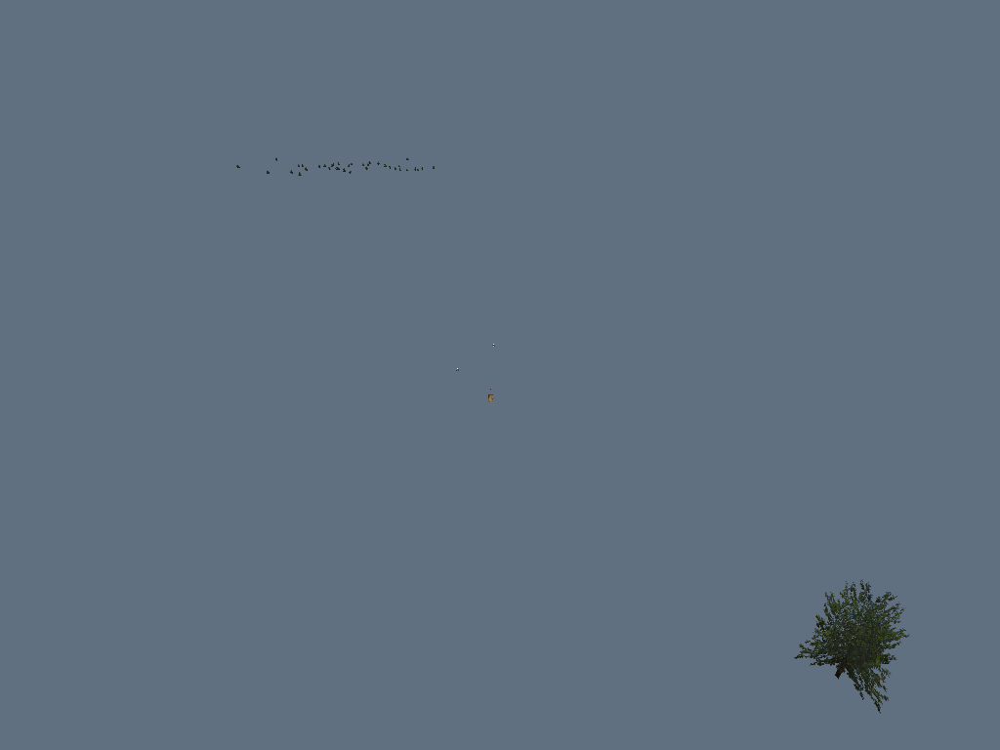
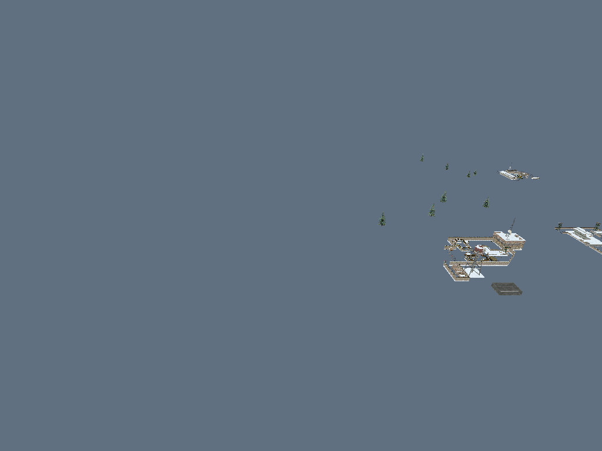
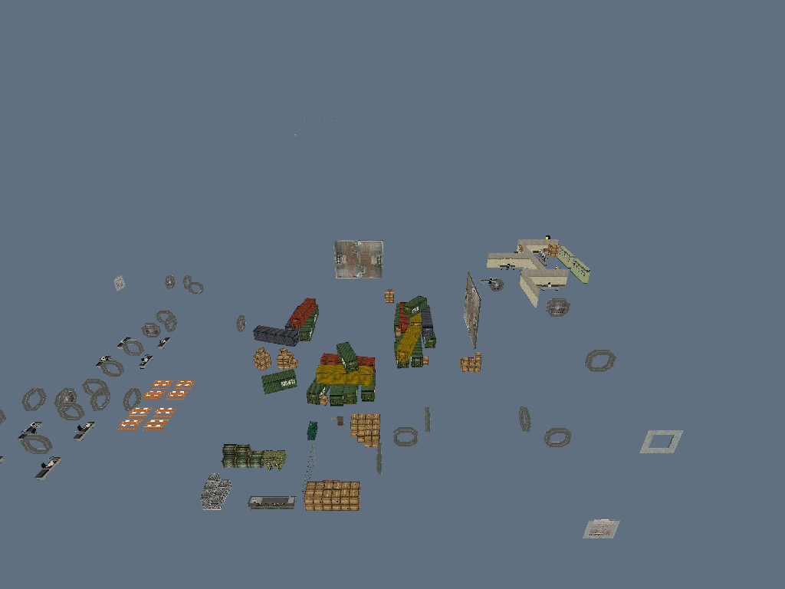

# Project Open I.G.I.

Project Open I.G.I. is a native integration of the original Project I.G.I. game engine. Engine routines are ported from reverse-engineering evidence taken directly from the retail igi.exe, with retail names, virtual addresses, calling conventions, and evidence references retained where known.

This repository is the game-engine implementation. It is not an editor, converter, helper library, or gameplay rewrite based on another project. The retail executable is the behavior authority. C# open-igi may identify candidate implementations, but REA/static/runtime evidence from retail igi.exe must verify behavior used here. Unknown behavior remains explicitly unresolved rather than guessed.

## Current status

The active Level 1 MVP is documented in MVP.md, with its required implementation sequence in plan.md: build the Windows x86 baseline; render models at transforms from OBJECTS.QVM; render terrain and textures; verify all visual assets and placements; then implement the playable simulation, player, physics/interactions, AI/navigation, health/damage, weapons, gameplay animation/effects, QVM flow, and sound.

### Task 1: early 3D model loading from QVM

The Windows executable now renders textured MEF models at declared `OBJECTS.QVM` positions using Direct3D 7.
MTP packages connect the models and materials to their original RES archives. All 14 levels produced a saved
rendered frame in the current scene test. Level 1 draws 441 initial model poses with 190 textures.

```console
open-igi.exe window level1
open-igi.exe window level5
```

Place the executable in the original game directory. These are model-loading scenes, not playable missions.
The camera and lighting are diagnostic; terrain, skinned actors, recursive attachments and other task types remain
incomplete. Some source model references remain unresolved. See the [test results, all 14 captures and native
address/name table](docs/TASK1_MODEL_LOADING.md) for coverage and limits.

| Level 1 | Level 3 |
|---|---|
|  |  |

| Level 11 | Level 14 |
|---|---|
|  |  |

Primary native anchors: `Qvm_Load` (`0x004B80B0`), `Resource_Load` (`0x004B5F00`),
`DynObj_InsertHashItem_14` (`0x004CF080`), `DynObj_LocalModelsSMef` (`0x004CF390`) and
`DisplayRender_Processmodelsnotconvert` (`0x0049DF60`). Names and addresses identify the research sources;
complete retail behavioral parity is not established by compilation or these screenshots.

Movies/cutscenes, vehicles, smoke effects, and the main menu are outside this playable-demo scope unless a Level 1 dependency is proven.

## Build

The target is a 32-bit Windows executable using the original DirectX 7 / DirectDraw platform APIs.

Requirements: CMake 3.20+, a C++20 compiler, and the Windows SDK or MinGW toolchain with DirectDraw 7 headers and libraries.

    cmake -S . -B build
    cmake --build build
    ctest --test-dir build --output-on-failure

## Reverse-engineering workflow

All behavioral implementation claims must trace back to igi.exe. Static analysis identifies candidate routines and data layouts; runtime tracing and memory inspection confirm behavior where possible; focused tests record verified conditions and known limits. A catalog entry or clean decompilation alone is not runtime proof.

Tools used for analysis and verification:

- Ghidra — disassembly, decompilation, and data-structure analysis.
- Binary Ninja — independent disassembly, decompilation, and control-flow analysis.
- radare2 — independent disassembly, control-flow, and binary inspection.
- Frida — runtime hooks, call tracing, and memory inspection.
- RE-Agent — orchestration of reverse-engineering analysis against the retail executable.

Per-routine evidence and implementation limits stay attached to native source and its analysis records. Tool output is evidence; it is not a substitute for the native engine implementation.

## Source layout

- engine/include/igi/retail/ — declarations for integrated retail routines.
- engine/src/retail/ — routine implementations, named and annotated with their retail addresses.
- engine/tests/ — focused tests for individual implementation slices.
- engine/REVERSE_ENGINEERING.md — provenance, evidence, and unresolved behavior.

## Windows runtime

The retail executable and this project target 32-bit Windows x86 and DirectX 7 / DirectDraw. The game is intended to run as a normal Windows game with its original assets. Keep Windows APIs in the Windows platform layer; shared engine routines retain retail behavior established from igi.exe.
