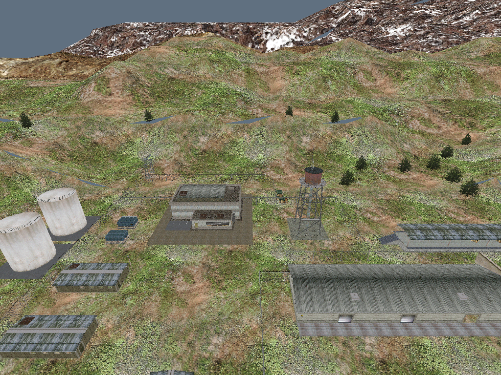
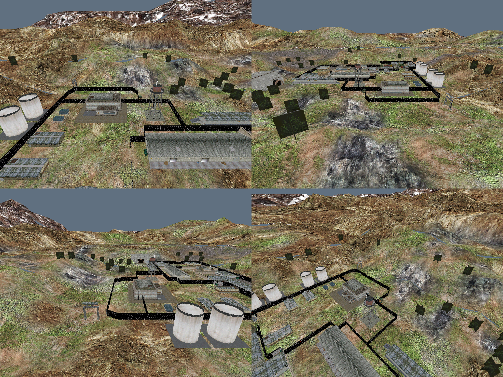
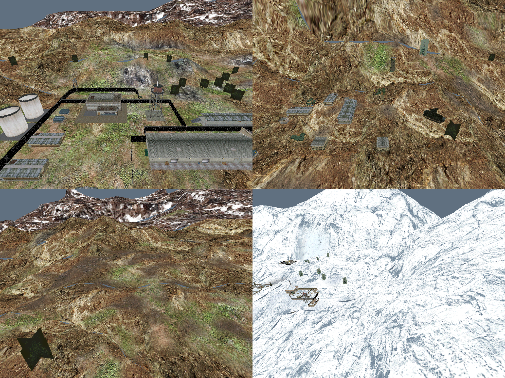
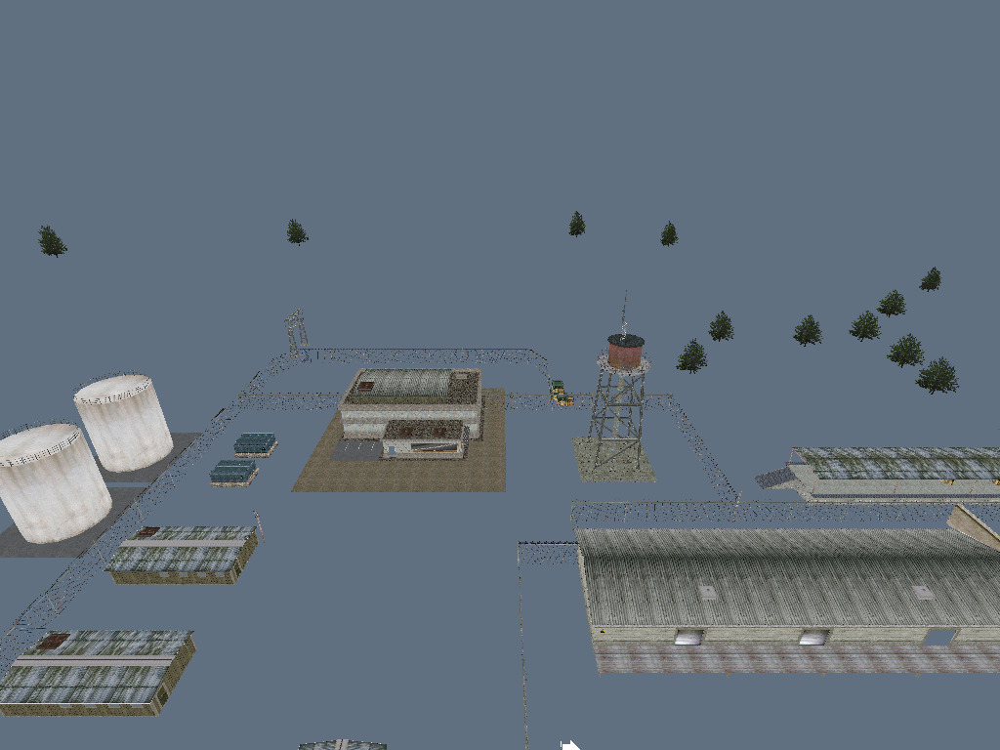
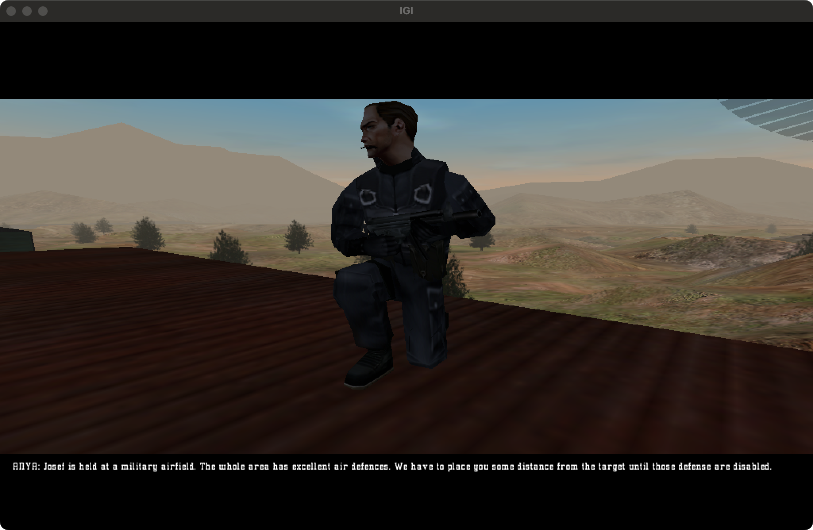

# Project Open IGI (C++20 Reconstruction)

[](LICENSE)
[-informational.svg)]()
[]()
[]()

**Project Open IGI** is an open-source native C++20 engine reconstruction and reverse-engineering platform for Innerloop Studios' tactical stealth shooter ***Project I.G.I.: I'm Going In* (2000)**. 

The engine routines are reconstructed through clean-room reverse engineering and paired static/runtime verification directly against retail `igi.exe` (SHA-256 `dea34892d417715873ea61d7b2ba5556655f1ad65385104348146f9679915a01`, image base `0x00400000`). All native functions preserve retail virtual addresses, original calling conventions (`__cdecl`), and rigorous control-flow graph (CFG) concordance.

---

## 📸 Screenshots Gallery

### Terrain & 3D Environment Rendering

Direct3D 7 textured terrain rendering with original multi-grid heightmaps and textures extracted from retail `.res` packages.

| Direct3D 7 Textured Level 1 Terrain | Multi-Angle 4-Grid Diagnostic Terrain Heights |
| :---: | :---: |
|  |  |

| Multi-Level Terrain Extraction & Grid Overview | Mission 1-14 3D Models Inspection |
| :---: | :---: |
|  |  |

---

### Retail Ground-Truth Baseline

Retail `igi.exe` runtime scene capture under Wine/CrossOver used as the ground truth behavioral reference for paired memory and state verification:



---

## 📁 Engine Source Directory Layout

The `engine` folder is structured into modular subsystems mirroring the retail architecture:

```
engine/
├── CMakeLists.txt
├── include/igi/retail/              # Retail native API headers & structures
│   ├── audio/                      # Audio subsystem, ADPCM decoding, sound attenuation
│   ├── config/                     # Retail game configuration, graphic options & input mapping
│   ├── core/                       # WinMain lifecycle, QTask scheduler, AppContext & game flow
│   ├── diagnostics/                # Engine diagnostic logging & trace infrastructure
│   ├── dynobj/                     # Dynamic objects, MTP packages, hash table lookups
│   ├── error/                      # Fatal runtime error reporting & exception handling
│   ├── human/                      # Player controller, camera view & locomotion
│   ├── input/                      # DirectInput 7 keyboard/mouse port processing
│   ├── mem/                        # Retail memory pool allocator & task bucket management
│   ├── model/                      # MEF 3D model entity loader, IFF skeleton & skinning
│   ├── qfile/                      # Virtual file system, device & driver lookup tables
│   ├── render/                     # DirectDraw 7 / Direct3D 7 rendering backend & view blocks
│   ├── resource/                   # RES archive unpacker, cache management & lifecycles
│   ├── script/                     # QVM bytecode script virtual machine & opcode dispatch
│   ├── sys/                        # Low-level platform system hooks & window management
│   ├── terrain/                    # Quadtree terrain LOD system & lightmap processing
│   └── texture/                    # Texture loading, palette uploading & mipmap management
├── platform/
│   └── windows/                    # Win32 PE subsystem & DirectX platform glue
├── src/retail/                     # Native implementation sources mapped to retail VAs
│   ├── audio/                      # Retail audio routines (e.g. AnimSound_Open 0x0051B400)
│   ├── config/                     # Config read/write routines (0x00405850, 0x00405BD0)
│   ├── core/                       # Entry point, startup sequence & flow controllers
│   ├── diagnostics/                # Runtime trace collectors
│   ├── dynobj/                     # Dynamic object visibility & bounding box routines
│   ├── error/                      # Error display handlers
│   ├── human/                      # Human player parameter & camera routines (0x004137A0)
│   ├── input/                      # DirectInput poll & key processing routines
│   ├── mem/                        # Allocation & bucket routines (0x004B0C60)
│   ├── model/                      # MEF/IFF model mesh & texture modifier routines (0x004ED6B0)
│   ├── qfile/                      # File I/O & alias resolution routines
│   ├── render/                     # Model & scene drawing routines (0x0049DF60)
│   ├── resource/                   # Resource archive load, unpack & flush (0x004B5F00, 0x004B63D0)
│   ├── script/                     # QVM opcode execution routines (0x004B80B0, 0x004BCFD0)
│   ├── sys/                        # Window callback & display context dispatchers
│   ├── terrain/                    # Terrain mesh & lightmap routines (0x004F8340)
│   └── texture/                    # Texture upload & pixel format conversions
└── tests/                          # Component unit & regression test suites
    ├── config/                     # Config parser verification tests
    ├── core/                       # Startup & input port tests
    ├── dynobj/                     # Hash lookup tests
    ├── error/                      # Error handling tests
    ├── model/                      # IFF skeleton parser tests
    ├── platform/                   # Player controller tests
    ├── render/                     # Transformation context tests
    └── terrain/                    # Terrain loader tests
```

---

## 🧩 Retail Game Native Database

The project maintains an authoritative native function catalog verified against the retail binary via Binary Ninja, Ghidra, radare2, and angr symbolic execution.

📖 **Full Database:** [`docs/fidelity/native-database.md`](docs/fidelity/native-database.md) (Over 1,500 catalogued native records with signatures, addresses, and CFG concordance).

### Discovered Retail Natives Summary

| Subsystem | Retail Function Name | Retail Address | Calling Conv | CFG Concordance | Status |
| :--- | :--- | :--- | :--- | :--- | :--- |
| **Config** | `Config_ResetGraphicOptions` | `0x00403B70` | `__cdecl` | `1.000` (100%) | Verified |
| **Config** | `Config_Read` | `0x00405850` | `__cdecl` | `1.000` (100%) | Verified |
| **Config** | `Config_Write` | `0x00405BD0` | `__cdecl` | `1.000` (100%) | Verified |
| **Config** | `Config_GetActivePlayerProfile` | `0x00406220` | `__cdecl` | `1.000` (100%) | Verified |
| **Human / AI** | `HumanPlayer_LoadParameters` | `0x004137A0` | `__cdecl` | `1.000` (100%) | Verified |
| **Human / AI** | `Human_HitDamage` | `0x00416D80` | `__cdecl` | `1.000` (100%) | Verified |
| **Camera** | `Human_ViewCam` | `0x00463760` | `__cdecl` | `1.000` (100%) | Verified |
| **App Context** | `StoreCommandLine` | `0x0048F0C0` | `__cdecl` | `1.000` (100%) | Verified |
| **App Context** | `StoreInstanceHandle` | `0x0048F0D0` | `__cdecl` | `1.000` (100%) | Verified |
| **Transform** | `Transcontext_SetActiveTransContext` | `0x00497E70` | `__cdecl` | `1.000` (100%) | Verified |
| **Model / Render**| `DisplayRender_DrawModel` | `0x0049DF60` | `__cdecl` | `1.000` (100%) | Verified |
| **Memory** | `Mem_Alloc` | `0x004B0C60` | `__cdecl` | `1.000` (100%) | Verified |
| **Resources** | `Resource_PackUnpack` | `0x004B18B0` | `__cdecl` | `1.000` (100%) | Verified |
| **Resources** | `Resource_Load` | `0x004B5F00` | `__cdecl` | `1.000` (100%) | Verified |
| **Resources** | `Resource_Flush` | `0x004B63D0` | `__cdecl` | `1.000` (100%) | Verified |
| **QVM Scripting**| `Qvm_Load` | `0x004B80B0` | `__cdecl` | `1.000` (100%) | Verified |
| **QVM Scripting**| `Qvm_ExecuteInstructions` | `0x004BCFD0` | `__cdecl` | `1.000` (100%) | Verified |
| **QVM Scripting**| `Qvm_SetOpcodeHandler` | `0x004BD3D0` | `__cdecl` | `1.000` (100%) | Verified |
| **QVM Scripting**| `Qvm_PushInteger` | `0x004BDA00` | `__cdecl` | `1.000` (100%) | Verified |
| **Model / Mesh** | `DynCubeObj_GetMaskVisibleEvent` | `0x004E5360` | `__cdecl` | `1.000` (100%) | Verified |
| **Animation** | `AnimTrigger_GetByte` | `0x004EC040` | `__cdecl` | `1.000` (100%) | Verified |
| **Model / Texture** | `TextureModifier_Init` | `0x004ED6B0` | `__cdecl` | `1.000` (100%) | Verified |
| **Terrain** | `TerrainLightMap_Init` | `0x004F8340` | `__cdecl` | `1.000` (100%) | Verified |
| **Container** | `Container_Init` | `0x00505C90` | `__cdecl` | `1.000` (100%) | Verified |
| **Audio** | `AnimSound_Open` | `0x0051B400` | `__cdecl` | `1.000` (100%) | Verified |

---

## 🏗️ Engine Architecture & Subsystems

The reconstructed engine faithfully mirrors the original architecture of the Innerloop engine:

- **Graphics Pipeline:** DirectDraw 7 and Direct3D 7 hardware-accelerated rendering targeting 32-bit Windows PE executables.
- **Data File Parsers:**
  - `MEF` (Model Entity Format) and `MTP` (Model Texture Package) for 3D hierarchical models.
  - `RES` archives for game levels, sounds, and configurations.
  - `ILFF` format for game data packages.
  - `QVM` bytecode virtual machine for mission logic, objective scripting, and AI triggers.
- **Terrain Engine:** Quadtree-based multi-grid heightmap LOD system with terrain lightmapping.
- **Verification Gate:** Strict verification pipeline combining CFG analysis (`native_gate.py`), radare2 / Binary Ninja decompilation checks, and angr register comparison.

---

## 🛠️ Building & Running

### Requirements
- **OS:** Windows x86 (or macOS/Linux with MinGW-w64 cross-compiler and Wine/CrossOver for testing)
- **CMake:** Version 3.20 or newer
- **Compiler:** C++20 compliant compiler (`i686-w64-mingw32-g++` for MinGW cross-builds or MSVC 32-bit)
- **DirectX:** DirectX 7 / DirectDraw SDK headers and libraries

### Build Instructions

```bash
# Standard enforced build with verification gates
./build.sh

# Diagnostic build
./build.sh --diagnostic
```

### Running

Copy the built executable into your retail Project I.G.I. game installation directory:

```cmd
open-igi.exe window level1
open-igi.exe window devmode level1
```

---

## 🔗 Related Projects in the I.G.I. Community

Explore other community reverse-engineering and preservation projects:
- [IGI-RE](https://github.com/slickdaddyy/IGI-RE) — Full decompiler project for Project I.G.I. 1.
- [igi-recomp](https://github.com/HenryKun55/igi-recomp) — Static binary recompilation for Project I.G.I. 1.
- [igi-vita](https://github.com/HenryKun55/igi-vita) — Native PlayStation Vita source port by @HenryKun55.
- [igi2-decomp](https://github.com/ShahriyarB/igi2-decomp) — Decompilation project for I.G.I. 2: Covert Strike.
- [OpenIGI](https://github.com/OpenIGI/OpenIGI) — Clean-room C# reimplementation on .NET 10.
- [project-igi-reverse-engineering](https://github.com/heaven-hm/project-igi-reverse-engineering) — Directory of I.G.I. reverse engineering and recompilation efforts.

---

## 📜 License & Legal Notice

This project is licensed under the [MIT License](LICENSE).

*Project I.G.I.: I'm Going In* and all associated retail assets, names, trademarks, and artwork are the property of Innerloop Studios, Eidos Interactive, Square Enix, and Toadman Interactive. This repository contains only clean-room reverse-engineered code and research documentation; retail assets are not distributed here.
